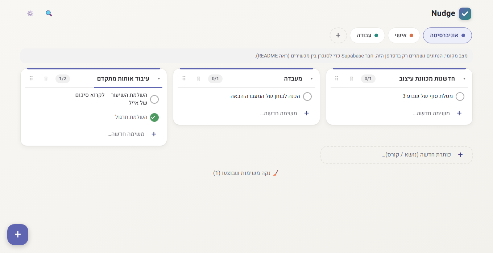

<div dir="rtl">

# Nudge ✨

🔗 **[לפתיחת האפליקציה: maozepstein.github.io/Nudge](https://maozepstein.github.io/Nudge/)**

אפליקציית משימות פשוטה ויפה בעברית: דפים לפי נושא, כותרות (למשל קורסים) ומשימות מתחתן. עובדת במחשב ובטלפון, מסתנכרנת ביניהם ויודעת להזכיר.



## מה יש בה

- **לשוניות (דפים)** לפי נושא – אישי, אוניברסיטה, עבודה… לכל דף צבע משלו.
- **כותרות** בתוך כל דף, ומתחתן **משימות**. עיגול לסימון עשיתי / לא עשיתי.
- **כמה עמודות זו לצד זו** כדי לראות הרבה משימות בבת אחת (או עמודה אחת – בהגדרות).
- **גרירה לסידור מחדש** של משימות (גם בין כותרות), כותרות ולשוניות.
- **תזכורות** עם התראות, כולל **משימות חוזרות** (יומי / שבועי / חודשי).
- **חיפוש** בכל הדפים והוספה מהירה מכל מקום.
- **ניקוי** משימות שבוצעו בלחיצה אחת, עם אפשרות ביטול.
- **עובדת גם בלי אינטרנט** – שינויים נשמרים ונשלחים כשהחיבור חוזר.
- **סנכרון** בין מחשב לטלפון. כניסה עם **Google**, עם **קישור במייל** (בלי סיסמה), או **כאורח** בלי שום חיבור.
- **מצב בהיר / כהה / אוטומטי** (בהגדרות) והתקנה כאפליקציה (PWA).

## שימוש

| פעולה | איך |
|---|---|
| דף חדש | כפתור `+` בשורת הלשוניות |
| עריכת דף (שם, צבע, מחיקה) | לחיצה נוספת על הלשונית הפעילה |
| סידור לשוניות | גרירה (בטלפון: לחיצה ארוכה וגרירה) |
| כותרת חדשה | התיבה המקווקוות בסוף הדף |
| משימה חדשה | התיבה בתחתית כל כותרת (Enter מוסיף ונשאר להקלדה הבאה) |
| **הוספה מהירה** | כפתור `+` הצף, או המקש **N** במחשב. בוחרים דף וכותרת ומקלידים |
| **חיפוש** | 🔍 למעלה, או המקש **/** |
| סימון בוצע | לחיצה על העיגול |
| סימון בוצע בהחלקה | החלקה **ימינה** על משימה (טלפון) מסמנת בוצע / לא בוצע |
| מחיקת משימה | החלקה **שמאלה** (טלפון) או ✕ (מחשב). אחרי מחיקה יש 5 שניות ל"↩ בטל" |
| **סידור מחדש** | גרירה בידית ⠿: משימה (גם לכותרת אחרת), כותרת (בתוך הדף) |
| כיווץ / פתיחת כותרת | החץ ▾ (כותרת שכל משימותיה בוצעו מתכווצת אוטומטית) |
| **ניקוי שבוצעו** | הכפתור "🧹 נקה משימות שבוצעו" בתחתית הדף (פועל על הדף הנוכחי) |
| תזכורת | 🔔 במשימה ← תאריך ושעה, ואפשר גם **🔁 חזרה** |
| עריכת טקסט | לחיצה על הכותרת; למשימה – לחיצה כפולה (מחשב) או הקשה (טלפון) |
| מראה, פריסה וצפיפות | ⚙️ הגדרות: **אוטומטי** (לפי המכשיר) / **בהיר** / **כהה**; **לרוחב** (ברירת מחדל) / **לאורך**; צפופה / רגועה |

### משימה חוזרת
בוחרים 🔔 תאריך ושעה ואז "חזרה". כשמסמנים את המשימה כבוצעה היא לא נסגרת אלא חוזרת אוטומטית למועד הבא (ומופיע הודעה עם התאריך).

---

## הרצה מקומית (בדיקה מהירה, בלי הגדרות)

```bash
npm install
npm run dev
```

פתח את הכתובת שמוצגת (בדרך כלל http://localhost:5173).
בלי Supabase האפליקציה עובדת ב**מצב מקומי**: הנתונים נשמרים רק בדפדפן הזה, עם נתוני דוגמה.

---

## הקמה מלאה (סנכרון + אתר באינטרנט)

### שלב 1 – Supabase (מסד הנתונים וההתחברות)

1. היכנס ל-[supabase.com](https://supabase.com), צור חשבון ופרויקט חדש (החבילה החינמית מספיקה).
2. בתפריט: **SQL Editor** ← New query ← הדבק את כל התוכן של [`supabase/schema.sql`](supabase/schema.sql) ← **Run**.
   > הקובץ בטוח להרצה חוזרת. **אחרי כל עדכון של האפליקציה כדאי להריץ אותו שוב**, כדי שעמודות וטבלאות חדשות יתווספו.
3. **Project Settings → API**: העתק את `Project URL` ואת מפתח ה-`anon public`.
4. **Authentication → URL Configuration**:
   - `Site URL`: כתובת האתר שלך (ראה שלב 3), למשל `https://maozepstein.github.io/Nudge/`
   - `Redirect URLs`: הוסף את אותה כתובת, וגם `http://localhost:5173/`.
5. **Authentication → Providers**: ודא ש-Email מופעל.
6. **כניסה עם Google** (לא חובה): ב-[Google Cloud Console](https://console.cloud.google.com/apis/credentials) צור OAuth Client ID מסוג Web, והוסף ב-Authorized redirect URIs את הכתובת `https://YOUR-PROJECT-REF.supabase.co/auth/v1/callback`. אחר כך ב-Supabase: **Authentication → Providers → Google** ← הפעל והדבק את Client ID ו-Client Secret. בלי ההגדרה הכפתור "המשך עם Google" יציג שגיאה, ואפשר להשתמש בקישור במייל.

> **כניסה כאורח:** הכפתור "כניסה כאורח" לא דורש הגדרה. הנתונים של אורח נשמרים רק בדפדפן ואינם מסתנכרנים; בלחיצה על "התחבר" אפשר לעבור לחשבון (המשימות שנוצרו כאורח לא עוברות אליו).

### שלב 2 – הגדרות מקומיות

העתק את `.env.example` ל-`.env` ומלא:

```
VITE_SUPABASE_URL=https://YOUR-PROJECT.supabase.co
VITE_SUPABASE_ANON_KEY=YOUR-ANON-PUBLIC-KEY
```

הרץ שוב `npm run dev` – עכשיו תופיע מסך כניסה במייל.

### שלב 3 – פרסום ב-GitHub Pages

1. בריפו ב-GitHub: **Settings → Secrets and variables → Actions → New repository secret**, והוסף:
   - `VITE_SUPABASE_URL`
   - `VITE_SUPABASE_ANON_KEY`
   - `VITE_VAPID_PUBLIC_KEY` – רק אם מפעילים התראות כשהאפליקציה סגורה (ראה בהמשך)
2. **Settings → Pages → Source: GitHub Actions**.
3. כל `push` ל-`main` בונה ומפרסם אוטומטית (ראה [`.github/workflows/deploy.yml`](.github/workflows/deploy.yml)).
4. הכתובת תהיה: `https://<שם-המשתמש>.github.io/Nudge/`

### שלב 4 – התקנה בטלפון סמסונג

1. פתח את כתובת האתר ב-**Chrome**.
2. תפריט ⋮ ← **הוספה למסך הבית** / **התקנת אפליקציה**.
3. התחבר באותו מייל – וכל המשימות יופיעו.

> **מעבר ל-Vercel בהמשך:** ייבא את הריפו ל-Vercel, הוסף את משתני הסביבה, ואל תגדיר `VITE_BASE` (ברירת המחדל `/` נכונה). זכור לעדכן גם את ה-Redirect URLs ב-Supabase.

---

## תזכורות

### בסיסי (עובד מיד, בלי הקמה)
- בלחיצה על 🔔 הדפדפן מבקש **אישור להתראות** – יש לאשר.
- התזכורת מופיעה כהתראה כשהאפליקציה **פתוחה או רצה ברקע** (מומלץ להתקין כאפליקציה).
- אם האפליקציה הייתה סגורה לגמרי, התזכורת תופיע ברגע שתפתח אותה, כבאנר עם כפתורי "בוצע" / "סגור".

### התראות כשהאפליקציה סגורה לגמרי (Push) – הקמה חד-פעמית
מצריך מחשב עם Node ו-[Supabase CLI](https://supabase.com/docs/guides/cli). ב-iPhone ההתראות עובדות רק אחרי התקנה למסך הבית.

1. **צור מפתחות:**
   ```bash
   npx web-push generate-vapid-keys
   ```
   יוצאים שני מפתחות: Public ו-Private. את ה-Public שמים גם ב-`.env` וגם כ-Secret ב-GitHub בשם `VITE_VAPID_PUBLIC_KEY`.
2. **התחבר ופרוס את הפונקציה:**
   ```bash
   supabase login
   supabase link --project-ref YOUR-PROJECT-REF
   supabase secrets set VAPID_PUBLIC_KEY=... VAPID_PRIVATE_KEY=... VAPID_SUBJECT=mailto:you@example.com CRON_SECRET=בחר-סיסמה-ארוכה
   supabase functions deploy send-reminders --no-verify-jwt
   ```
3. **תזמן הרצה כל דקה:** פתח את [`supabase/push-cron.sql`](supabase/push-cron.sql), החלף את `YOUR-PROJECT-REF` ואת `YOUR-CRON-SECRET` (אותו ערך כמו `CRON_SECRET`) והרץ ב-SQL Editor.
4. **הפעל בכל מכשיר:** באפליקציה ⚙️ הגדרות ← "התראות כשהאפליקציה סגורה" ← הפעל ואשר.

---

## גיבוי נתונים

כל הנתונים נשמרים ב-Supabase. לגיבוי: **Table Editor** ← בחר טבלה ← Export to CSV (פעם בכמה זמן, לשלוש הטבלאות `pages`, `sections`, `tasks`).

## מבנה הפרויקט

```
src/
  App.tsx               התחברות + המסך הראשי + גרירה
  components/           Tabs, SectionCard, TaskItem, ReminderPicker, SearchDialog, QuickAdd, SettingsDialog, Login
  lib/useData.ts        כל הנתונים: טעינה, עדכונים מיידיים, תור לעבודה בלי חיבור, סנכרון חי
  lib/reminders.ts      בדיקת תזכורות והתראות מקומיות
  lib/recurrence.ts     חישוב מועד הבא למשימה חוזרת וסדר גרירה
  lib/push.ts           הרשמה להתראות Push
  sw.ts                 Service Worker (התקנה, Push, לחיצה על התראה)
  styles.css            כל העיצוב והצבעים
supabase/
  schema.sql            טבלאות והרשאות (כל משתמש רואה רק את שלו)
  functions/send-reminders/   שליחת Push לתזכורות שהגיע זמנן
  push-cron.sql         תזמון ההרצה כל דקה
scripts/make-icons.mjs  יצירת אייקוני האפליקציה (npm run icons)
```

## פקודות

| פקודה | תיאור |
|---|---|
| `npm run dev` | שרת פיתוח |
| `npm run build` | בדיקת טיפוסים ובנייה לפרודקשן (`dist/`) |
| `npm run preview` | הרצת הגרסה הבנויה מקומית |

## פתרון בעיות

- **לא מגיע מייל כניסה** – בדוק בספאם, וודא ש-Email מופעל ב-Supabase. בחבילה החינמית יש הגבלת מספר מיילים לשעה.
- **הקישור מהמייל מפנה לכתובת לא נכונה** – עדכן `Site URL` ו-`Redirect URLs` ב-Supabase.
- **שגיאה על עמודה חסרה (`repeat` וכד')** – הרץ שוב את `supabase/schema.sql`.
- **המשימות לא מסתנכרנות** – ודא שהרצת את `schema.sql` כולו (כולל החלק האחרון של Realtime).
- **אין התראות** – בדוק שאישרת התראות לאתר בהגדרות הדפדפן/הטלפון. להתראות כשהאפליקציה סגורה – ודא שהשלמת את כל שלבי ה-Push.
- ב-GitHub Pages נטען קובץ ישן אחרי עדכון – רענון קשיח (Ctrl+Shift+R), או סגירה ופתיחה של האפליקציה המותקנת.

</div>
